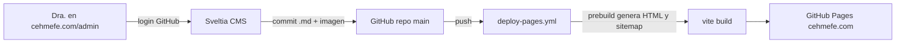

# CMS basado en Git para el blog (Sveltia CMS)

**Estado:** guardado para ejecutar después (2026-10-16).  
**No implementar** hasta que se pida explícitamente.

**Antes de empezar:** hacer commit de lo pendiente (posts gripe + acretismo, y título h1 más pequeño) para separarlo de esta migración.

## Overview

Añadir un CMS gratis y sin servidor ([Sveltia CMS](https://github.com/sveltia/sveltia-cms)) en `cehmefe.com/admin` para que la Dra. Mónica pueda escribir y publicar posts desde el navegador. Los posts se guardan como Markdown en este repo y el workflow de GitHub Pages reconstruye y despliega automáticamente. Sin servidor y sin base de datos.

## Respuesta corta (Payload vs esta opción)

- **¿Payload es open source?** Sí (MIT), pero es una app Next.js que necesita un servidor Node y una base de datos (Postgres, MongoDB o SQLite). No puede vivir dentro de este proyecto Vite en GitHub Pages: requeriría un servidor aparte y pagado.
- **Opción elegida:** CMS basado en Git (Sveltia, compatible con Decap). Cuesta $0, no necesita servidor ni BD y el sitio sigue en GitHub Pages.
- **Dónde quedan los datos:** el propio repo. Cada post es un archivo Markdown en `src/content/blog/` y cada imagen va en `public/assets/blog/`.

## Cómo funciona

Al publicar, el sitio se actualiza en unos 2–3 minutos. El workflow actual ([.github/workflows/deploy-pages.yml](../.github/workflows/deploy-pages.yml)) ya corre en cada push a `main`.

## Checklist de implementación

1. [ ] Commit de trabajo pendiente (gripe, acretismo, h1 más pequeño)
2. [ ] Renombrar posts `.mdx` → `.md`; configurar MDX `format: 'detect'` en `vite.config.mts`; actualizar glob en `src/blog/posts.js` + fallback EN→ES
3. [ ] Añadir `scripts/generate-blog-pages.mjs` (gray-matter) para generar `blog/<slug>/index.html` + `sitemap.xml`; `predev`/`prebuild`; inputs dinámicos en Vite; gitignore de HTML generados
4. [ ] Añadir `public/admin/index.html` (Sveltia CDN, noindex) y `public/admin/config.yml` con los campos de frontmatter actuales
5. [ ] Acceso de la Dra.: cuenta GitHub + invite Write; desplegar `sveltia-cms-auth` Worker + GitHub OAuth App (o PAT como fallback)
6. [ ] Verificar build, posts, sitemap, `/admin`; probar crear un post en local

## Cambios detallados

### 1. Panel `/admin`

- `public/admin/index.html`: carga `@sveltia/cms` desde CDN y lleva `noindex`.
- `public/admin/config.yml` define:
  - backend `github`, repo `chekku-inc/cehmefe-landing-page`, rama `main`;
  - `media_folder: public/assets/blog` y `public_folder: assets/blog`;
  - colección `blog` en `src/content/blog`, extensión `md`, slug `{{fields.slug}}`;
  - campos: `titleEs`, `excerptEs`, `categoryEs` (select), `readTimeEs`, `date`, `cover`, `coverAltEs`, `body`; versiones `...En` opcionales; `author` oculto con default `monica-garcia`; `slug` autogenerado.

### 2. Markdown en lugar de MDX

El MDX se rompe con caracteres como `{` o `<` en un editor visual.

- Renombrar posts actuales de `.mdx` a `.md` (ninguno usa JSX).
- En `vite.config.mts`: `mdx({ format: 'detect', mdExtensions: ['.md'], ... })`.
- En `src/blog/posts.js`: glob `'../content/blog/*.{md,mdx}'` y fallback ES cuando falte EN (`titleEn ?? titleEs`, etc.).

### 3. Generar automáticamente las páginas de cada post

Hoy cada post necesita `blog/<slug>/index.html`, entrada en Vite y sitemap a mano. Automatizar:

- Script `scripts/generate-blog-pages.mjs` con `gray-matter`:
  - escribe `blog/<slug>/index.html` (meta, OG, Twitter, JSON-LD `BlogPosting`);
  - escribe `public/sitemap.xml` (rutas fijas + todos los posts).
- En `package.json`: `"predev"` y `"prebuild": "node scripts/generate-blog-pages.mjs"`.
- En `vite.config.mts`: `rollupOptions.input` dinámico listando `blog/*/index.html`.
- En `.gitignore`: ignorar `blog/*/index.html` y conservar `blog/index.html`. Quitar del repo los HTML generados que hoy están versionados.

### 4. Acceso de la Dra.

- Cuenta de GitHub + invite al repo con permiso **Write**.
- Login recomendado: “Sign in with GitHub” vía [sveltia-cms-auth](https://github.com/sveltia/sveltia-cms-auth) (Cloudflare Worker gratis) + GitHub OAuth App; `base_url` en `config.yml`.
- Alternativa: token personal de GitHub limitado a este repo (Contents: read/write).
- Limitación: con Write puede modificar todo el repo; el CMS solo le muestra el blog.

### 5. Verificación

- `npm run build`: posts generan HTML, sitemap completo, `/admin` carga.
- Post de prueba desde `/admin` en local (Sveltia + repo local en Chrome), revisar y borrar.
